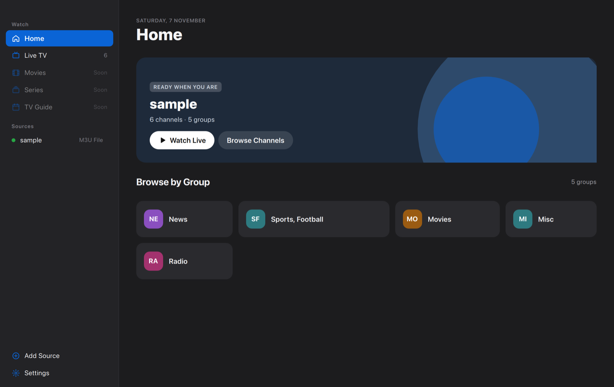
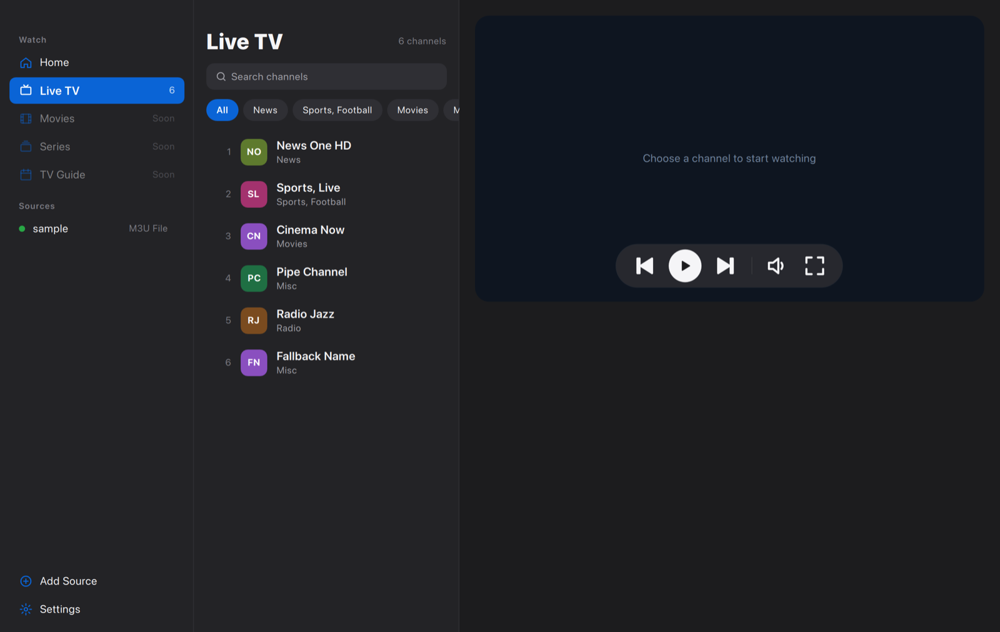
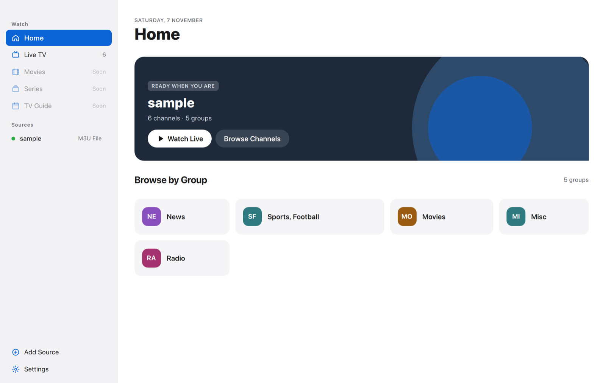
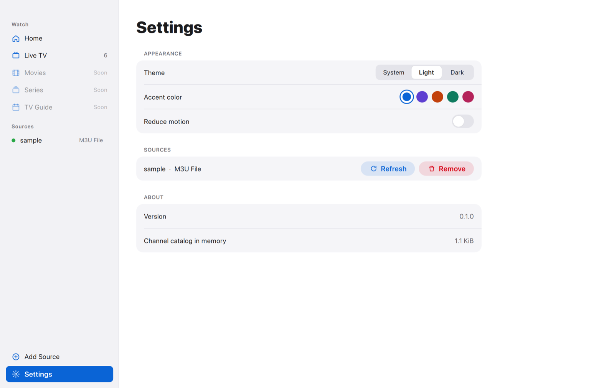

<div align="center">

# IPTVX

**A fast, beautiful and memory‑frugal IPTV player for macOS, Windows and Linux — built with Qt 6 and modern C++.**

[](https://github.com/BirdRa1n/IPTVX/actions/workflows/ci.yml)


[](LICENSE)



</div>

> [!IMPORTANT]
> IPTVX is a **player**. It does not provide, sell or bundle any channels,
> playlists or subscriptions. Bring your own M3U playlist or provider account.

---

## ✨ Highlights

|  |  |
|---|---|
| 🎨 **Aurora design** | A SwiftUI‑inspired interface: translucent sidebar with a spring‑animated selection, large titles, inset forms, glass player controls and fluid page transitions. Light, dark and system appearance with custom accent colors. |
| 🪶 **Built to be light** | Channels live in a compact columnar store (≈44 bytes + UTF‑8 text per channel), playlists are parsed as a stream, only one catalog is resident at a time and artwork is cached on disk. See [Memory strategy](docs/MEMORY.md). |
| 📺 **Your sources** | M3U / M3U8 from a URL (cached for offline start) or a local file, and Xtream Codes accounts. Stalker portals are on the [roadmap](docs/ROADMAP.md). |
| ⚡ **Native & fast** | C++20 core, QML compiled ahead of time, playback through Qt Multimedia's FFmpeg backend, heavy work on worker threads. |
| ⌨️ **Keyboard friendly** | Space to play/pause, `M` mute, `F` full screen, arrows for volume, `⌘/Ctrl+N` add a source, `⌘/Ctrl+1/2` switch pages. |
| 🌍 **Localized** | English and Brazilian Portuguese. |

## 📸 Screenshots

| Live TV (dark) | Home (light) |
|---|---|
|  |  |

<p align="center"></p>

## 🚀 Getting started

### Requirements

| Tool | Version |
|---|---|
| Qt | **6.9 or newer** with Qt Quick, Quick Controls 2, Multimedia, SQL, Network, Concurrent, Linguist Tools |
| CMake | 3.21+ |
| Compiler | Clang 15+, GCC 12+ or MSVC 2022 (C++20) |
| Generator | Ninja (recommended) |

### Build & run

```bash
# Point CMake at your Qt installation
export CMAKE_PREFIX_PATH="$HOME/Qt/6.12.0/macos"   # e.g. …/gcc_64 on Linux, …\msvc2022_64 on Windows

cmake --preset release
cmake --build --preset release
./build/release/src/app/IPTVX.app/Contents/MacOS/IPTVX   # macOS
./build/release/src/app/IPTVX                            # Linux / Windows
```

Run the tests:

```bash
cmake --preset debug && cmake --build --preset debug
ctest --preset debug
```

Platform notes, packaging and the developer/sandbox mode are covered in
[docs/DEVELOPMENT.md](docs/DEVELOPMENT.md).

## 🧭 Project layout

```
IPTVX/
├── src/
│   ├── core/        # GUI-free C++ domain layer (static lib iptvx_core)
│   │   ├── model/   # ChannelStore, Source
│   │   ├── parser/  # Streaming M3U/M3U8 parser
│   │   ├── provider/# Xtream Codes client
│   │   ├── service/ # PlaylistLoader (file / URL cache / Xtream)
│   │   ├── storage/ # SQLite database, migrations, repositories
│   │   └── util/    # StringTable (interning)
│   ├── ui/          # QML module IPTVX.UI (static lib iptvx_ui)
│   │   ├── models/  # QAbstractListModels exposed to QML
│   │   └── qml/     # theme/, components/, pages/, player/, sheets/
│   └── app/         # Executable: main.cpp + developer tooling
├── tests/           # Qt Test suites + synthetic fixtures
├── i18n/            # Translations (.ts)
├── docs/            # Architecture, memory, design, development, roadmap
├── cmake/           # Shared compiler settings
└── AGENTS.md        # Guide for AI coding agents
```

## 📚 Documentation

| Document | What's inside |
|---|---|
| [Architecture](docs/ARCHITECTURE.md) | Layers, data flow, threading, persistence |
| [Memory strategy](docs/MEMORY.md) | How IPTVX keeps its footprint low, rules for new code |
| [Design system](docs/DESIGN.md) | Aurora tokens, components, motion, the three design concepts |
| [Development](docs/DEVELOPMENT.md) | Building on each OS, presets, testing, dev mode, i18n |
| [Roadmap](docs/ROADMAP.md) | Feature parity plan with established IPTV players |
| [Contributing](CONTRIBUTING.md) | Workflow, commit style, code style |
| [AGENTS.md](AGENTS.md) | Rules and entry points for AI coding agents |

## 🙏 Acknowledgements

Feature scope was inspired by the open-source
[IPTVnator](https://github.com/4gray/iptvnator) project. IPTVX is an
independent implementation in Qt/C++ and shares no code or assets with it.

## 📄 License

[MIT](LICENSE) © Dário Jr
