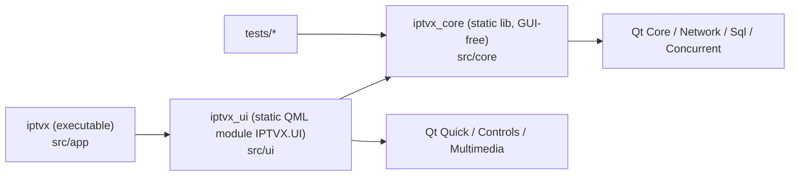
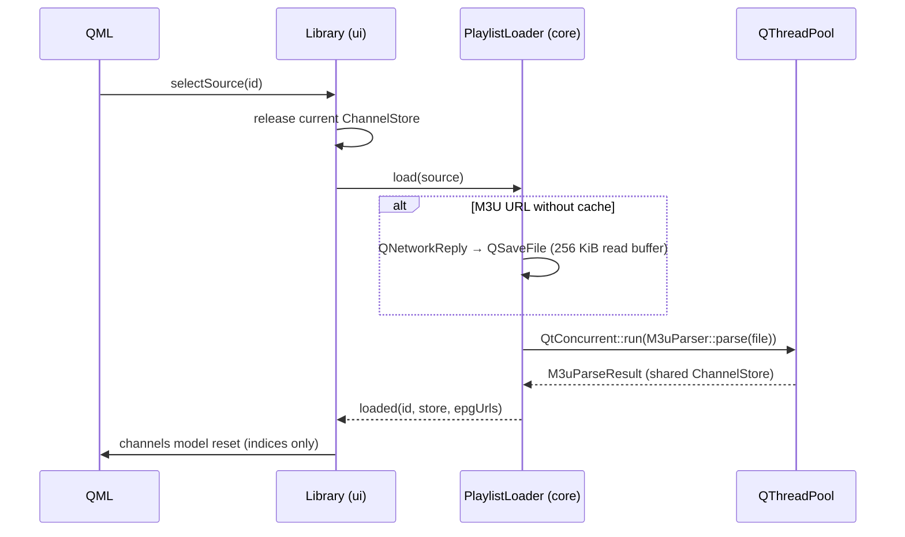

# Architecture

IPTVX is split into three CMake targets with a strict, one-way dependency
direction:

| Layer | May depend on | Must not depend on |
|---|---|---|
| `core` | Qt Core, Network, Sql, Concurrent | Qt Gui, Qml, Quick, Multimedia, `ui`, `app` |
| `ui` | `core`, Qt Quick, Controls, Multimedia | `app` |
| `app` | `ui`, `core`, platform SDKs (`platform/`, e.g. AppKit) | — |

Keeping `core` GUI-free means every parser, provider and repository is unit
tested without a display, and could be reused by a CLI or another front end.

## Core (`src/core`)

| Module | Responsibility |
|---|---|
| `model/ChannelStore` | Compact, append-only columnar storage of a catalog. Text in one UTF-8 arena; group/user-agent/referrer interned to 16-bit ids. Published as `std::shared_ptr<const ChannelStore>` (immutable, thread-safe reads). |
| `model/Source` | A configured playlist/account (M3U file, M3U URL, Xtream, Stalker). |
| `parser/M3uParser` | Streaming extended-M3U parser (one reused line buffer, cancellable). |
| `provider/XtreamClient` | Async Xtream Codes client + pure URL/JSON helpers. |
| `service/PlaylistLoader` | Turns a `Source` into a `ChannelStore`: parse file, stream URL to a disk cache then parse, or query Xtream. Supersedes stale loads via a generation counter. |
| `storage/Database` | SQLite connection (WAL, small page cache) + ordered migrations in `PRAGMA user_version`. |
| `storage/SourceRepository` | CRUD for sources. |
| `update/Release` | Version comparison, GitHub release parsing, platform/CPU detection and asset selection. |
| `update/UpdateService` | Queries `/releases/latest`, streams the asset to disk and verifies size + SHA-256. |
| `update/UpdateInstaller` | Swaps the .app (macOS), replaces the AppImage (Linux) or runs the silent installer (Windows), then relaunches. |
| `util/StringTable` | Deduplicating string table addressed by `quint16`. |

### Loading a source

## UI (`src/ui`)

* **C++ ↔ QML boundary** — `Library` and `Updates` are `QML_SINGLETON` facades; models are
  `QAbstractListModel`s registered with `QML_ELEMENT`. QML never sees core
  types directly.
* **`Library.search`** is a second `ChannelListModel` over the same store
  for the command palette; it matches nothing while the query is empty.
* **`ChannelListModel`** holds the shared store plus a `std::vector<quint32>`
  of filtered row indices. Group filtering compares interned ids; text search
  first tries a byte match before allocating a temporary `QString`.
* **QML structure**

  | Folder | Contents |
  |---|---|
  | `qml/theme` | `Theme` singleton — every color, radius, spacing, font, duration |
  | `qml/shell` | `Rail`, `TopBar` (source switcher), `CommandPalette` |
  | `qml/components` | Reusable controls (`PillButton`, `Chip`, `SegmentedControl`, `SearchField`, `ToggleSwitch`, `ChannelLogo`, `Icon`, …) |
  | `qml/pages` | `DashboardPage`, `LiveTvPage`, `SettingsPage` |
  | `qml/player` | `VideoPlayer` (Live TV surface), `MiniPlayer` (in-app picture-in-picture) |
  | `qml/sheets` | Modal flows (`AddSourceSheet`) |
  | `qml/Session.qml` | UI session state + persisted preferences |

* **Playback** — `Session.player` is the app's single `MediaPlayer`. It
  outlives pages, so playback continues while browsing. The Live TV
  `VideoPlayer` and the floating `MiniPlayer` only *borrow* its video output
  (one decoder and one set of frame buffers for the whole app).
* **Navigation** — `Session.page` drives a `StackView.replace`; pages are
  created on entry and destroyed on exit.
* **Compilation** — QML is compiled ahead of time (`qmlcachegen`/`qmlsc`)
  and linted with `qmllint` (`cmake --build … --target all_qmllint`).

## Threading

| Work | Thread |
|---|---|
| UI, models, SQLite, network I/O callbacks | GUI thread |
| M3U parsing, Xtream JSON → store conversion | `QThreadPool::globalInstance()` via `QtConcurrent::run` |
| Video decoding/rendering | Qt Multimedia internal threads + scene graph render thread |

Results cross threads only as immutable `shared_ptr<const ChannelStore>`.

## Persistence

| What | Where |
|---|---|
| Sources, favorites, history | SQLite `AppDataLocation/iptvx.db` |
| Cached remote playlists | `CacheLocation/playlists/<sourceId>.m3u` |
| Artwork HTTP cache (128 MiB cap) | `CacheLocation/artwork` |
| UI preferences | `QSettings` (`ui/*`, `updates/autoCheck`) |
| Downloaded updates | `CacheLocation/updates` |

Migrations are append-only: never edit a released migration in
`Database.cpp`; add a new entry to `kMigrations`.
