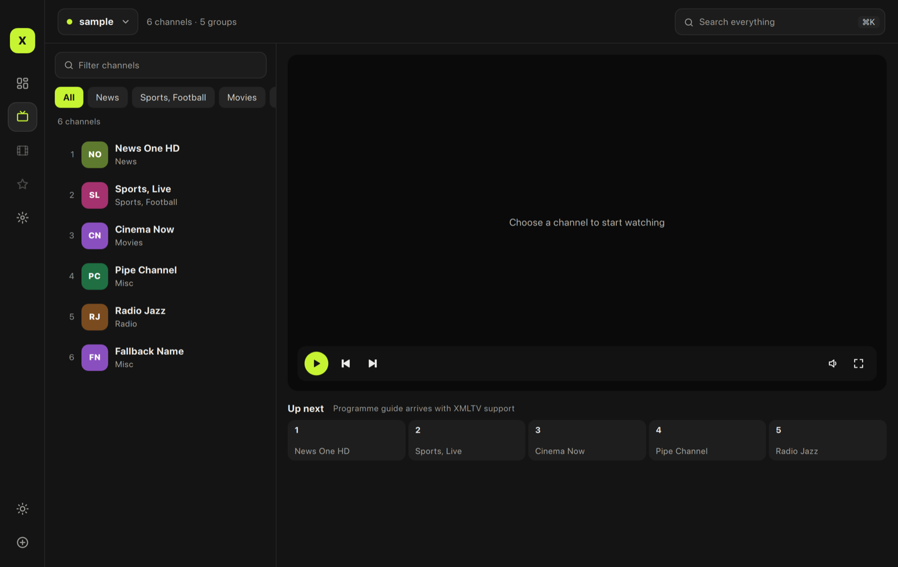
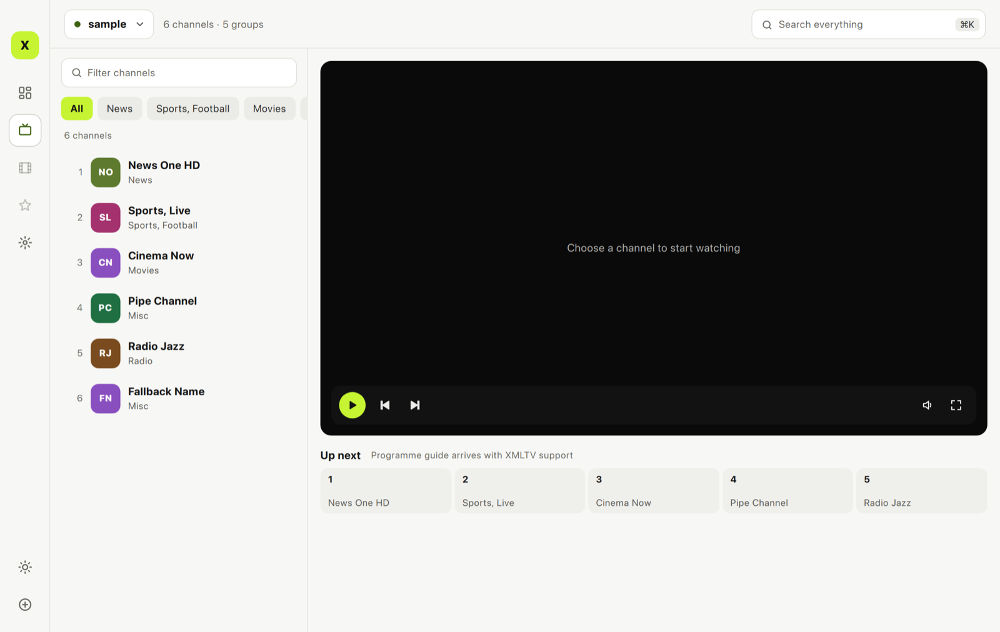
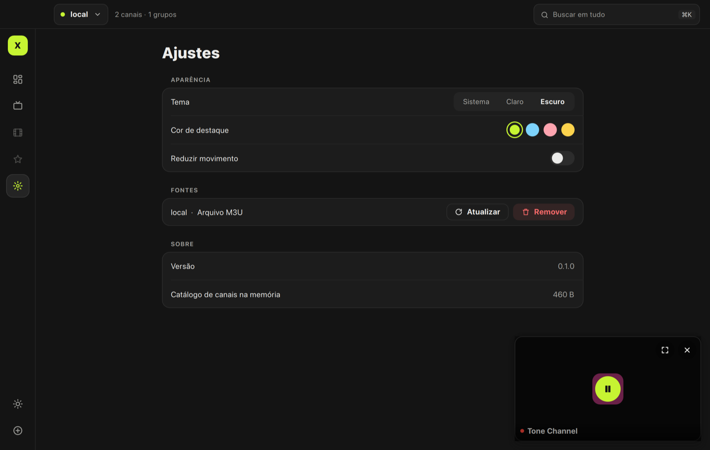
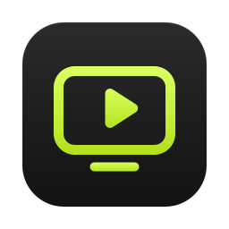

# Design system

IPTVX ships the **Workspace** design system — graphite surfaces, one vivid
accent, a compact icon rail and a keyboard-first command palette — in
**dark and light** appearances. It was chosen from eight explored concepts.

| Dark | Light |
|---|---|
|  |  |

## Concepts explored

| Concept | Personality | Status |
|---|---|---|
| A · Aurora | SwiftUI / macOS — calm, translucent sidebar, large titles | Shipped first, replaced by Workspace |
| B · Cinema | Immersive, poster-first, gold accent | Concept |
| C · Nebula | Dense navy, EPG timeline grid | Concept |
| D · Broadcast | Swiss grid, giant channel numbers, number-dial zapping | Concept |
| E · Spatial | visionOS-style floating glass and ornaments | Concept |
| F · Tonal | Material Expressive, couch/D-pad focus | Concept |
| G · Index | Typography-only minimalism | Concept |
| **H · Workspace** | Inspired by IPTVnator's workspace, reimagined: icon rail, source switcher, ⌘K palette, up-next/EPG ribbon, source health | ✅ **Implemented** |

## Tokens (`src/ui/qml/theme/Theme.qml`)

All visual values come from the `Theme` singleton. **Never hard-code a color,
radius, spacing, font or duration in a component.** The video surface is the
only exception: it is always dark, so overlays on it use `videoText` /
`videoTextSecondary` / `overlay` in both appearances.

### Color

| Token | Dark | Light | Use |
|---|---|---|---|
| `bg` | `#141414` | `#F7F7F5` | Window, rail, panes |
| `surface` | `#1C1C1C` | `#FFFFFF` | Cards, inputs, popovers |
| `raised` | `#242424` | `#FFFFFF` | Selected row / rail plate |
| `hover` | `#202020` | `#EFEFEC` | Hover state |
| `chip` / `cell` | `#242424` / `#1E1E1E` | `#EBEBE7` / `#EFEFEC` | Chips, segmented track / ribbon & grid cells |
| `divider` / `border` / `borderStrong` | `#262626` / `#2E2E2E` / `#3A3A3A` | `#E4E4E0` / `#E1E1DC` / `#CFCFC9` | Hairlines |
| `textPrimary` / `textSecondary` / `textTertiary` | `#ECECEA` / `#A8A8A4` / `#9A9A96` | `#141414` / `#55554F` / `#66665F` | Text hierarchy (≥ 4.5:1) |
| `accent` | preset fill | preset fill | Filled buttons, active chips, progress |
| `accentForeground` | `#141414` | `#141414` | Text/icons **on** the accent fill |
| `accentText` | = accent | darker preset variant | Accent used as text, icons, thin indicators |
| `accentSoft` | accent 12 % | accentText 12 % | Tinted backgrounds |
| `live`, `success`, `warning`, `danger` | | | Status |

Accent presets (`Theme.accentPresets`): **lime** `#C6F432` (default,
light text `#3F6212`), sky `#7DD3FC` (`#075985`), rose `#FDA4AF`
(`#9F1239`), amber `#FCD34D` (`#92400E`). Accents are bright *fills*: never
put white text on them, and never use the raw fill as text on a light
background — use `accentText`.

### Shape, spacing, sizes

* Radii: `radiusSmall 8`, `radiusMedium 10`, `radiusLarge 14`, `radiusXL 16`.
* Spacing: `4 · 8 · 12 · 16 · 20 · 26 · 32` (`space1` … `space7`).
* Rail 64 px, channel pane 330 px, control height 38 px.

### Typography

Platform font (SF Pro / Segoe UI / desktop font) — no font files shipped.

| Style | Size / weight |
|---|---|
| `largeTitle` | 28 / ExtraBold |
| `title` | 22 / ExtraBold |
| `title2` | 17 / ExtraBold |
| `headline` | 14 / Bold |
| `body` | 14 |
| `callout` | 13 |
| `caption` | 12 |
| `sectionLabel` | 11 / Bold, uppercase |

### Motion

| Token | Value | Use |
|---|---|---|
| `durationFast` | 120 ms | Hover, press, color |
| `durationMedium` | 220 ms | Panels, overlay, page enter |
| `durationSlow` | 360 ms | Sheets, palette, empty states |
| Springs | `SpringAnimation { spring: 4.5–5; damping: 0.38–0.4 }` | Rail plate, segmented thumb, switch knob |
| `Easing.OutBack` (`springOvershoot` 1.2) | | Sheet and palette scale-in |

`Theme.reduceMotion` (Settings › Reduce motion) collapses durations to 0.

## Structure

| Area | Files |
|---|---|
| Shell | `qml/shell/Rail.qml`, `TopBar.qml` (source switcher), `CommandPalette.qml` |
| Pages | `qml/pages/DashboardPage.qml`, `LiveTvPage.qml`, `SettingsPage.qml` |
| Components | `PillButton`, `Chip`, `SearchField`, `SegmentedControl`, `ToggleSwitch`, `ChannelRow`, `ChannelLogo`, `EmptyState`, `Icon` |

## Mini player (in-app picture-in-picture)

When a channel is playing and the user leaves Live TV, a 336 × 189 mini
player springs in at a corner of the content area and playback continues.
It always shows the channel name (and the channel logo for audio-only or
connecting streams); hovering reveals play/pause, *back to Live TV* and
*close*. Drag it anywhere — on release it snaps to the nearest corner on a
spring. Clicking the video returns to Live TV. Closing it stops playback.

## App icon

Master artwork: `resources/icons/iptvx.svg` — a graphite squircle on the
macOS icon grid (824 px body on a 1024 px canvas) with a lime screen and
play mark. Platform files (`iptvx.icns`, `iptvx.ico`, PNGs) are generated
from it with `cmake -DIPTVX_BUILD_TOOLS=ON` and `--target icons`.

## Window chrome (macOS)

`src/app/platform/WindowChrome_mac.mm` hides the native title text, makes
the title bar transparent and installs an empty unified toolbar, so the
traffic lights are vertically centred in a 52 pt bar. It then measures the
buttons and hands their rect to QML (`Main.titleBarControls`):

* the top bar height is derived from the buttons' vertical centre, so its
  controls share their centre line;
* the top bar's left inset clears the last button;
* the rail reserves the same strip at the top (no vertical hairline through
  the buttons);
* the top bar and the rail strip drag the window; double-click zooms.

Other platforms keep their native frame (`WindowChrome.cpp` is a no-op and
the top bar is 62 px).

## Accessibility

* Icon-only buttons set `Accessible.name` (rail buttons also show tooltips).
* Focus rings use `accentText`.
* Contrast ≥ 4.5:1 for text in both appearances.
* Keyboard: ⌘/Ctrl+K palette, ⌘/Ctrl+1/2 pages, ⌘/Ctrl+N add source,
  Space/M/F/↑/↓ in the player.

## QML pitfall

Never name a property `on<Something>` (e.g. `onAccent`, `onVideo`): QML
parses it as a signal handler and the whole singleton fails to load at run
time — qmllint does **not** catch it.
