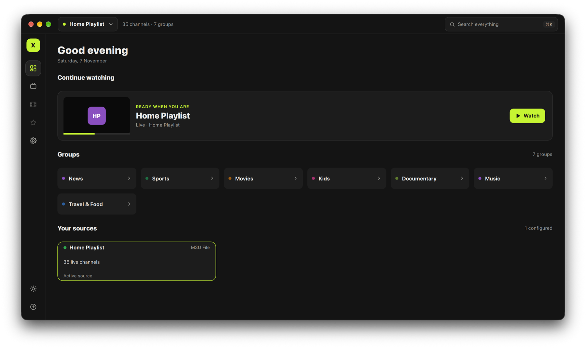
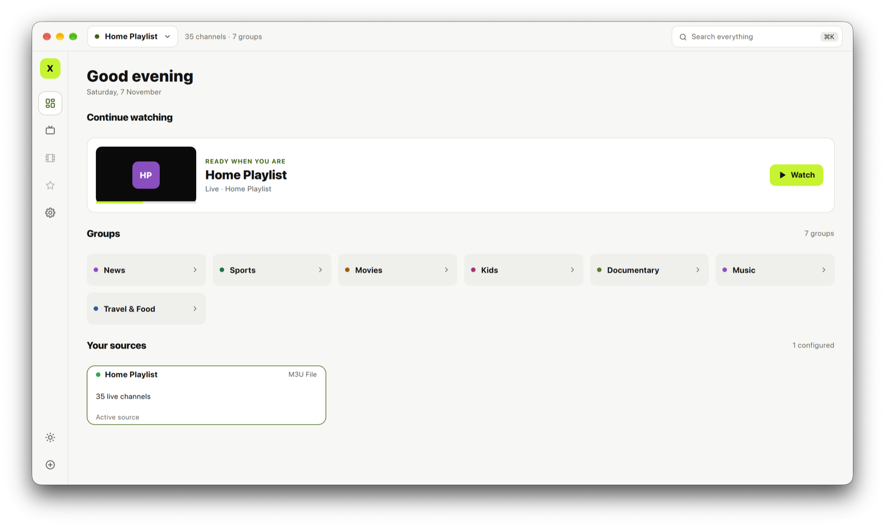
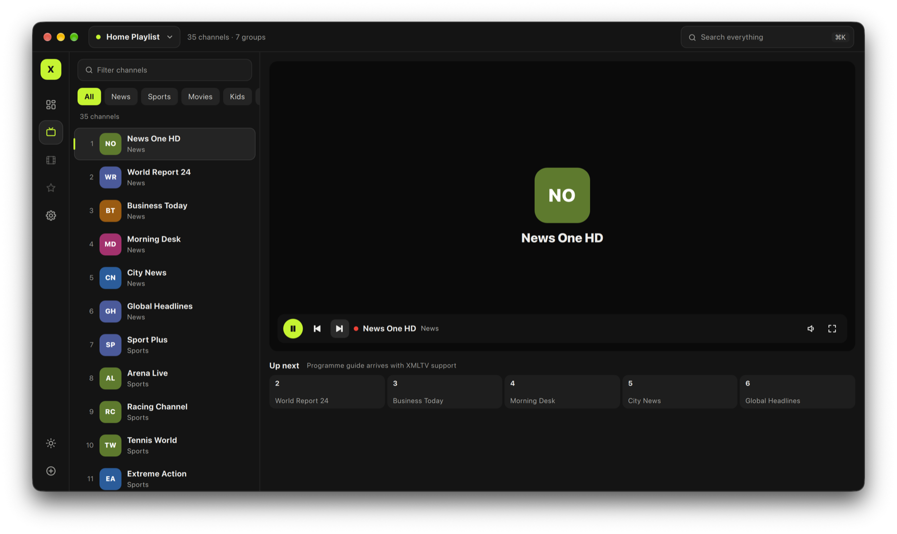
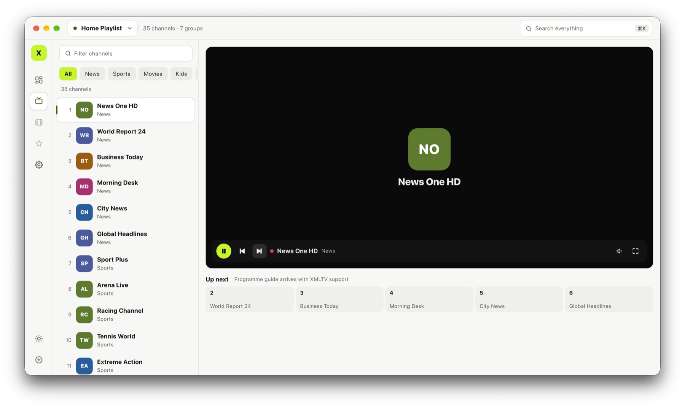
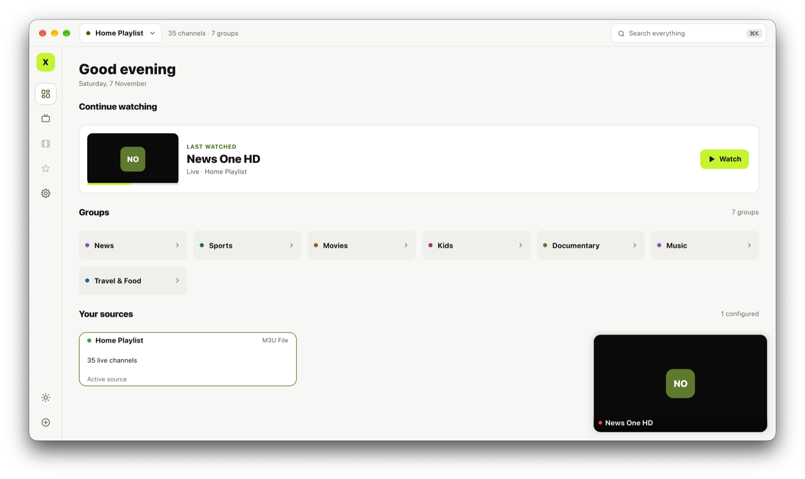
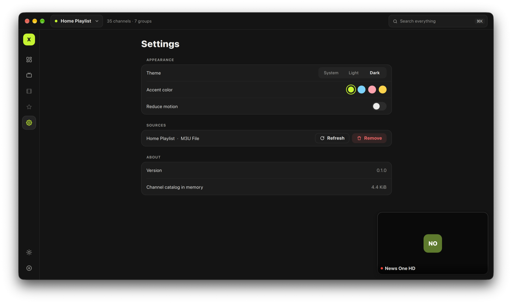
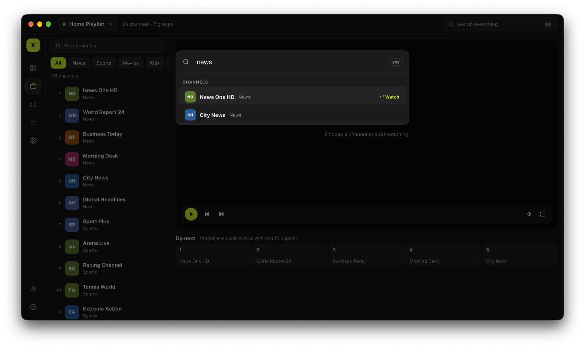
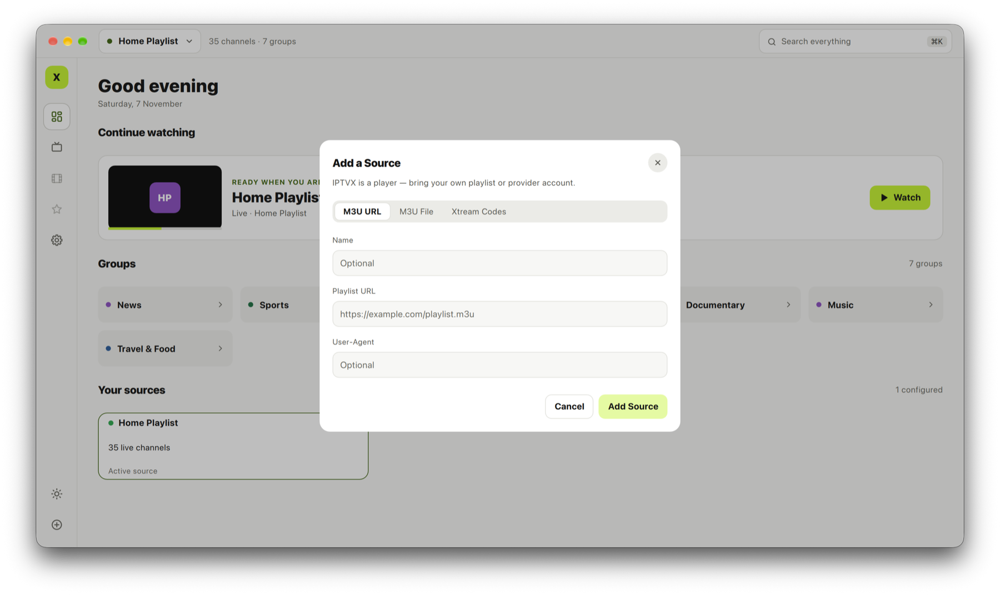
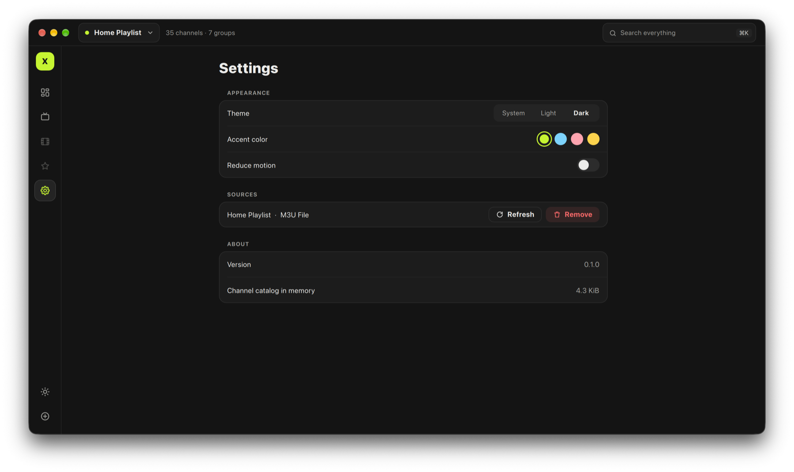

# Screenshots

[Back to README](../README.md)

Every screen ships in **dark and light** appearances. All content below is
synthetic demo data ([`docs/demo/demo.m3u`](demo/demo.m3u)) — IPTVX does not
provide channels.

## Dashboard

Greeting, continue watching, groups and source health.

| Dark | Light |
|---|---|
|  |  |

## Live TV

Channel filter, group chips and a recycled channel list beside the player.
Radio and still-connecting streams show the channel identity; the up-next
ribbon will host the programme guide.

| Dark | Light |
|---|---|
|  |  |

## Mini player

Leave Live TV and the channel keeps playing in a floating, draggable
picture-in-picture window that snaps to the nearest corner.

| Light — over the dashboard | Dark — over settings |
|---|---|
|  |  |

## Command palette and adding a source

`⌘K` / `Ctrl+K` searches channels and runs commands; sources are added from a
sheet (M3U URL, M3U file or Xtream Codes).

| Command palette — dark | Add a source — light |
|---|---|
|  |  |

## Settings

Appearance (system / light / dark), accent presets, reduced motion, sources
and the memory used by the channel catalog.



---

### Regenerating the gallery

```bash
cmake --preset debug && cmake --build --preset debug
tools/screenshots.sh
```

On macOS the captures include the native window frame (traffic lights,
rounded corners, shadow) through `screencapture -l`; give your terminal the
**Screen Recording** permission for that. Without it the app composites an
equivalent frame at the measured position of the window controls. See
[DEVELOPMENT.md](DEVELOPMENT.md#developer-mode-sandbox-seeding-screenshots) for
the individual `IPTVX_*` switches.
